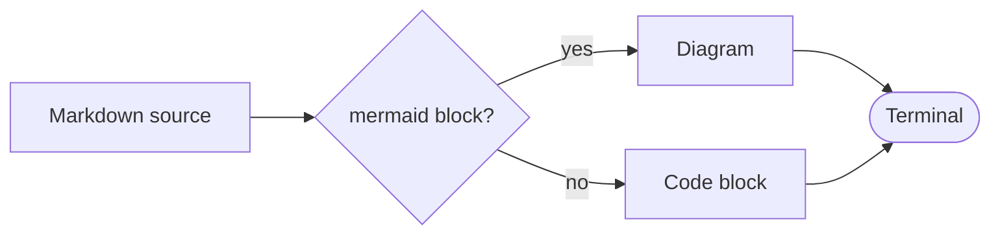

# Release notes

Elui draws **Markdown** in the terminal: *emphasis*, `inline code`,
~~struck text~~ and [links](https://elui.sh), word-wrapped to the window.

## What's new

- [x] A dependency-free Markdown parser
- [x] Tables that narrow to fit
- [ ] Your next feature

1. Parse once with `Elui.Markdown.parse/1`
2. Draw every frame with `Elui.Widgets.Markdown`

> Quotes keep their bar on every line, however
> the text wraps.

| Widget    | Draws                   | Since |
|:----------|:------------------------|------:|
| Markdown  | documents               |   0.1 |
| Mermaid   | flowcharts, sequences   |   0.1 |

```elixir
Markdown.new(text, block: Block.bordered(title: "Notes"))
```

## A diagram, in Markdown



---

Diagrams that don't fit the width show their source instead.
